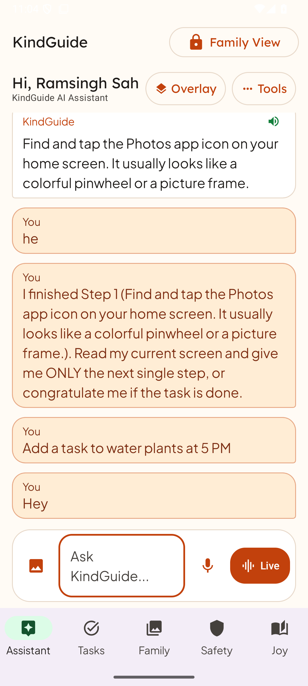
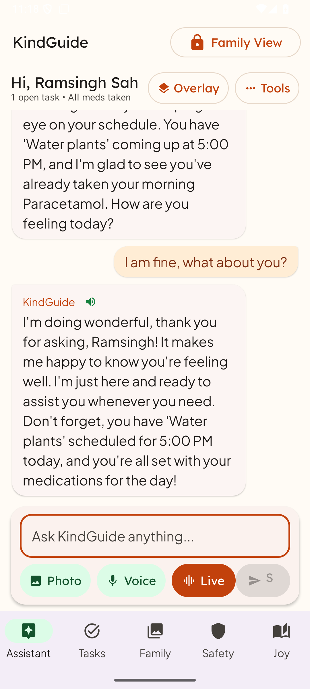
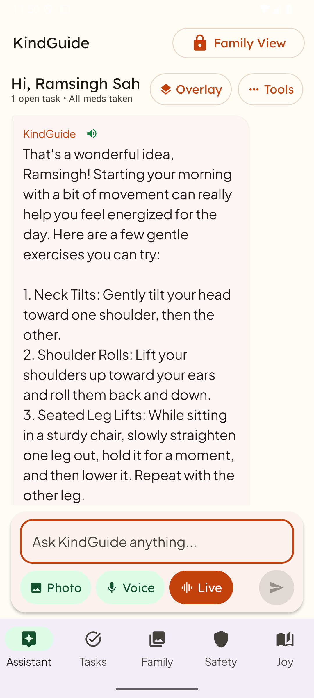
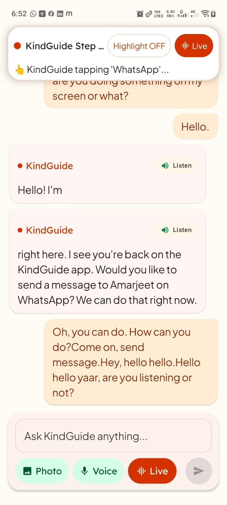
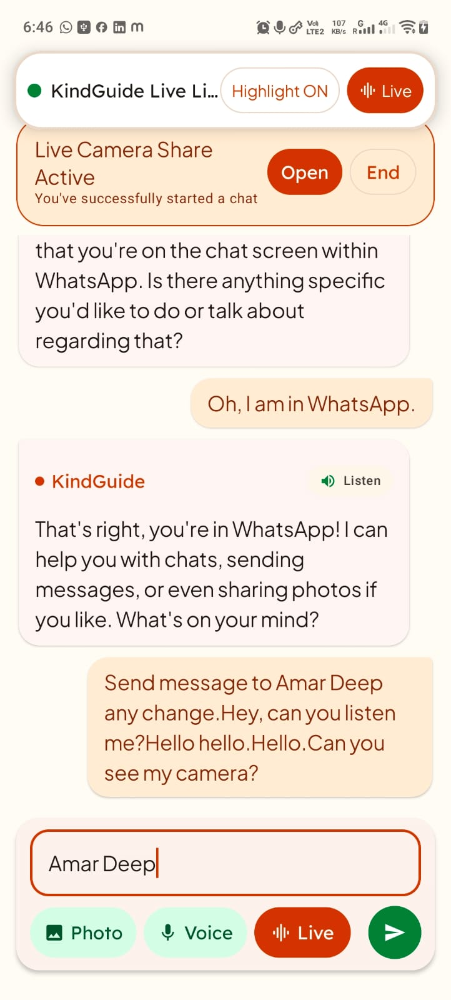
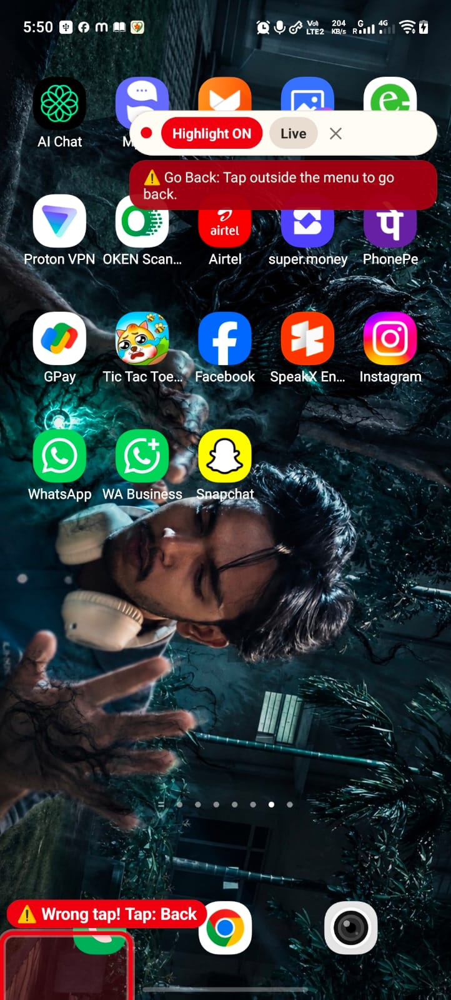

# KindGuide

Voice-first AI smartphone guide, cross-app step coach, medication tracker, and real-time family care circle for seniors.

---

## 1. Problem Statement

* **Complex Smartphone UIs:** Small icons, nested menus, and multi-step flows (e.g., WhatsApp, Photos, Settings) overwhelm older adults.
* **No Real-Time On-Screen Guidance:** Seniors get stuck mid-task outside help apps without visual cues or wrong-tap recovery.
* **Medication Non-Adherence:** Missed daily doses, forgotten dosages, and lack of clear historical adherence trends.
* **Safety & Scam Vulnerability:** Exposure to SMS/screenshot phishing scams and delayed emergency response when lost or in distress.
* **Caregiver Blind Spots:** Family members lack real-time visibility into tasks, medication adherence, and SOS visual context.

---

## 2. Architecture

```text
+-----------------------------------------------------------------------------------+
|                        UI Layer (Jetpack Compose + Material 3)                    |
|  SeniorHomeDashboard | SeniorHomeAndCoach | GeminiLiveScreen | SafetyAndMapScreen |
|  MedicationHistoryScreen (7-Day Canvas Chart) | CaregiverDashboard | OverlayCoach |
+-----------------------------------------+-----------------------------------------+
                                          |
                                          v
+-----------------------------------------------------------------------------------+
|                     Coordination & State Layer (MVVM / StateFlow)                 |
|  KindGuideViewModel  |  GuideSessionCoordinator  |  InterruptController           |
|  TaskExecutionHandler (Step-by-Step TTS + Barge-In) | SosCaptureManager           |
+-------------------+-----------------------------+---------------------------------+
                    |                             |
                    v                             v
+-----------------------------------+   +-------------------------------------------+
|   AI, Voice & Accessibility       |   |       Data & Persistence Layer            |
| - Firebase AI Logic (Gemini Live  |   | - Room DB v3 (KindGuideDatabase)          |
|   Bidi Audio/Vision + Scam/Story) |   |   * medication_schedules (with dosage)    |
| - ScreenGuideAccessibilityService |   |   * medication_history (TAKEN / MISSED)   |
|   (Node Tree + Gesture Dispatch)  |   | - AlarmManager + NotificationManager      |
| - Android SpeechRecognizer & TTS  |   | - Firebase Auth (Credential Manager)      |
+-----------------------------------+   | - Cloud Firestore (Care Circles & Alerts) |
                                        +-------------------------------------------+
```

### Core Components

| Layer | Component | Responsibility |
| :--- | :--- | :--- |
| **Voice & Live AI** | `GeminiLiveManager` & `KindGuideAiService` | Real-time bidirectional Gemini Live voice/camera/screen streaming, noise-gated barge-in, and multimodal scam analysis via Firebase AI Logic. |
| **Cross-App Coach** | `ScreenGuideAccessibilityService` & `TaskExecutionHandler` | Reads non-sensitive UI nodes, highlights target buttons, detects wrong taps, dispatches gestures, and speaks TTS step confirmations. |
| **Interrupt Engine** | `InterruptController` | Monitors live user speech/input mid-task to immediately abort abandoned sub-steps and pivot to new commands. |
| **Local Persistence** | `KindGuideDatabase` (Room v3) & `MedicationNotificationManager` | Stores `medication_schedules` (including `dosage` & custom reminder times) and `medication_history` (`TAKEN`/`MISSED`), triggering daily `AlarmManager` notifications. |
| **Cloud Sync & SOS** | `KindGuideRepository` & `SosCaptureManager` | Syncs Care Circle tasks, calendar events, photos, voice notes, and 7-frame SOS burst captures (screen + front/back cameras) to Firestore. |

---

## 3. How It Works

1. **Authenticate & Link Care Circle:** Sign in with Google (`CredentialManager`); create a Senior Care Circle or join via Family Link Code + 4-digit PIN.
2. **Speak or Type Any Request:** Ask KindGuide in natural language or launch **Gemini Live** for real-time two-way voice and screen/camera sharing.
3. **Guided Cross-App Execution:**
   * `ScreenGuideAccessibilityService` inspects on-screen labels and draws a floating step coach + target highlight box.
   * `TaskExecutionHandler` executes or guides one step at a time, speaking TTS confirmation after each completed action.
   * `InterruptController` listens continuously—if the user says *"stop"* or pivots tasks, current sub-steps abort immediately.
4. **Track Medications & Adherence Trends:**
   * Add daily medicines with `dosage`, time slot, and custom alarm time stored locally in Room (`medication_schedules`).
   * Daily notifications offer one-tap **Mark Taken** actions; `MedicationScheduleRepository` logs `TAKEN` and reconciles overdue `MISSED` doses into `medication_history`.
   * `MedicationHistoryScreen` renders a native Compose `Canvas` **7-Day Adherence Trend** chart (stacked bars + adherence % line) alongside date-range (`Today`, `7 Days`, `30 Days`, `All Time`, `Custom`) and status filters.
5. **Stay Protected (Scam Check, Safe Map & Quick SOS):**
   * Paste suspicious texts or upload screenshots for instant AI scam verdicts.
   * Use the Safe Places radar map for **Take Me Home** walking directions or trigger **Quick SOS** to stream GPS + 7 safety captures to family caregivers.

---

## 4. UI Workflow Screenshots

| 1. Voice-First AI Assistant & Task Setup | 2. Context-Aware Daily Schedule & Meds Check |
| :---: | :---: |
|  |  |
| *Single-step app guidance & natural-language task creation* | *Proactive task & morning medication status in chat* |

| 3. Personalized Senior Wellness Coaching | 4. Real-Time Gemini Live & Automated App Actions |
| :---: | :---: |
|  |  |
| *Large-print, read-aloud daily wellness guidance* | *Floating Step Coach executing cross-app WhatsApp actions* |

| 5. Live Camera/Screen Share in Third-Party Apps | 6. Cross-App Highlight Overlay & Wrong-Tap Guard |
| :---: | :---: |
|  |  |
| *Bidi Gemini Live voice + camera/screen context* | *Live target highlight box & instant wrong-tap recovery* |
